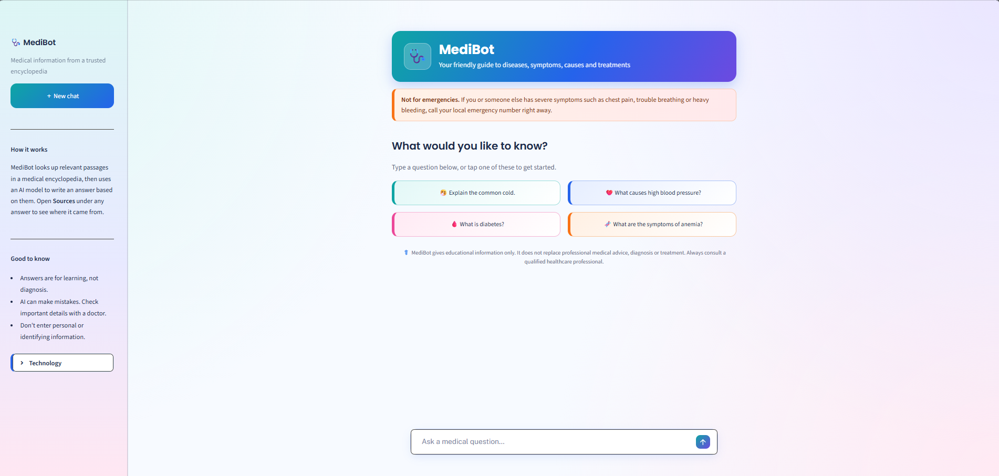
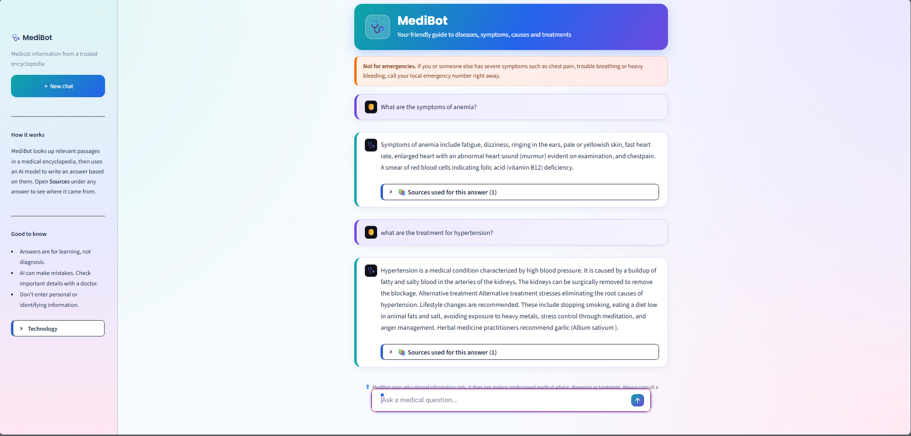

# 🩺 MediBot – RAG-Powered Medical Chatbot

An AI-powered medical knowledge assistant built using **Retrieval-Augmented Generation (RAG)**, **LangChain**, **Pinecone**, **Hugging Face**, and **Streamlit**.

MediBot allows users to ask medical questions in natural language and receive informative, context-based answers by retrieving relevant information from a medical encyclopedia stored in a Pinecone vector database.

The application combines semantic search with language generation to make medical information easier to access and understand.

---

## 🌐 Live Demo

**Try MediBot:** https://medical-rag-chatbot-ritu.streamlit.app/


---

## 📸 Application Screenshots

### 1. Chat Interface

Users can enter medical questions and interact with the chatbot through a conversational interface.



### 2. Generated Medical Response

MediBot retrieves relevant medical information and generates an easy-to-understand response.




---

## 📌 Table of Contents

1. [Project Overview](#-project-overview)
2. [Problem Statement](#-problem-statement)
3. [Project Objectives](#-project-objectives)
4. [Key Features](#-key-features)
5. [Technology Stack](#-technology-stack)
6. [System Architecture](#-system-architecture)
7. [How the Project Works](#-how-the-project-works)
8. [RAG Implementation](#-rag-implementation)
9. [Project Structure](#-project-structure)
10. [Installation and Setup](#-installation-and-setup)
11. [Environment Configuration](#-environment-configuration)
12. [Running the Application](#-running-the-application)
13. [Deployment](#-deployment)
14. [Example Questions](#-example-questions)
15. [Limitations](#-limitations)
16. [Future Improvements](#-future-improvements)
17. [Disclaimer](#-medical-disclaimer)

---

## 📖 Project Overview

MediBot is a Retrieval-Augmented Generation (RAG) based medical chatbot designed to make medical information more accessible through natural language interaction.

Traditional chatbots may generate responses using only the information learned during model training. This can result in outdated, incomplete, or unsupported information.

To address this limitation, MediBot uses a medical encyclopedia as an external knowledge source.

When a user asks a question, the system:

1. Converts the question into a numerical vector using a sentence-transformer embedding model.
2. Searches Pinecone for semantically relevant medical information.
3. Retrieves the most relevant document chunks.
4. Combines the retrieved information into a context.
5. Passes the context and user question to FLAN-T5.
6. Generates a natural-language response.
7. Displays the response and retrieved source information through Streamlit.

This approach helps ground the generated responses in the information available in the medical knowledge base.

---

## ❗ Problem Statement

Accessing reliable medical information can be difficult for users who are unfamiliar with medical terminology or need simple explanations.

Searching through lengthy medical documents manually can be time-consuming.

A conventional chatbot may also generate answers that are not directly supported by a specific medical reference.

MediBot addresses these challenges by providing a conversational interface connected to a searchable medical encyclopedia.

The objective is to simplify access to medical knowledge through semantic retrieval and AI-based response generation.

---

## 🎯 Project Objectives

- Build an interactive medical question-answering application.
- Implement a Retrieval-Augmented Generation architecture.
- Process and index a medical encyclopedia PDF.
- Store document embeddings in Pinecone.
- Retrieve relevant medical information using semantic similarity.
- Generate context-based answers using FLAN-T5.
- Provide a simple and readable Streamlit interface.
- Display retrieved medical sources alongside generated answers.

---

## ✨ Key Features

### 1. Natural Language Medical Queries

Users can ask questions using everyday language instead of searching manually through a medical document.

### 2. Retrieval-Augmented Generation

The system retrieves relevant information from the medical encyclopedia before generating an answer.

### 3. Semantic Search

Uses sentence-transformer embeddings to identify relevant information based on semantic meaning rather than relying only on exact keyword matching.

### 4. Pinecone Vector Database

Stores and searches the vector representations of medical document chunks.

### 5. AI-Based Answer Generation

Uses Google's FLAN-T5 Large model to generate natural-language responses using retrieved medical context.

### 6. Source Information

Displays retrieved source documents, page information, and relevant content.

### 7. Interactive Streamlit Interface

Provides:

- Conversational question-answering.
- Suggested medical questions.
- Chat history during the session.
- New Chat functionality.
- Clear Chat functionality.
- Expandable medical source sections.

### 8. Medical Information Disclaimer

Clearly communicates that the chatbot is an educational tool and not a replacement for professional medical advice.

---

## 🛠️ Technology Stack

| Technology | Purpose |
|---|---|
| Python | Core programming language |
| Streamlit | Interactive frontend |
| LangChain | RAG workflow and document retrieval |
| Pinecone | Cloud vector database |
| Hugging Face | Embedding and language models |
| Sentence Transformers | Text embedding generation |
| all-MiniLM-L6-v2 | Converts text into 384-dimensional embeddings |
| FLAN-T5 Large | Context-based answer generation |
| PyPDF | PDF document processing |
| RecursiveCharacterTextSplitter | Splits documents into smaller chunks |
| HuggingFaceEmbeddings | Generates document and query embeddings |
| LangChain Pinecone | Connects LangChain with Pinecone |
| python-dotenv | Loads environment variables |

---

## 🏗️ System Architecture

MediBot follows a Retrieval-Augmented Generation architecture.

```text
                  USER
                    |
                    v
             Medical Question
                    |
                    v
             STREAMLIT APP
                    |
                    v
             BACKEND.PY
                    |
                    v
             QUESTION EMBEDDING
          (all-MiniLM-L6-v2)
                    |
                    v
             PINECONE SEARCH
                    |
                    v
          RETRIEVE TOP-K DOCUMENTS
                    |
                    v
           CONTEXT PREPARATION
                    |
                    v
          QUESTION + CONTEXT
                    |
                    v
             FLAN-T5 LARGE
                    |
                    v
          GENERATED MEDICAL ANSWER
                    |
                    v
             STREAMLIT UI
                    |
          ---------------------
          |                   |
          v                   v
     FINAL ANSWER       SOURCE DETAILS
```

### Overall Workflow

```text
Medical Encyclopedia PDF
          |
          v
    PDF Document Loading
          |
          v
    Text Extraction
          |
          v
    Text Cleaning
          |
          v
    Document Chunking
          |
          v
    Embedding Generation
          |
          v
    Pinecone Vector Database
          |
          |
          |       USER QUESTION
          |             |
          |             v
          |      Query Embedding
          |             |
          |             v
          |      Semantic Search
          |             |
          |             v
          |      Relevant Chunks
          |             |
          |             v
          |      Context Preparation
          |             |
          |             v
          |      FLAN-T5 Generation
          |             |
          |             v
          |      Final Answer
          |             |
          |             v
          |      Streamlit Interface
          |
          v
     RAG KNOWLEDGE BASE
```

---

## ⚙️ How the Project Works

### Step 1: Medical PDF Loading

The medical encyclopedia is used as the external knowledge source.

The PDF is loaded using LangChain's `PyPDFDirectoryLoader`.

The loader extracts text and associated metadata, including source information and page details.

### Step 2: Text Extraction and Cleaning

Extracted PDF text may contain:

- Unnecessary whitespace.
- Formatting artifacts.
- Words split across lines.
- PDF-specific formatting characters.

Text cleaning helps normalize the extracted content before further processing.

### Step 3: Document Chunking

A complete medical encyclopedia is too large to pass directly into a language model.

Therefore, the extracted text is divided into smaller chunks using `RecursiveCharacterTextSplitter`.

The original ingestion configuration uses:

| Parameter | Value |
|---|---:|
| Chunk size | 800 |
| Chunk overlap | 50 |

**Chunk size:** Controls the approximate size of each text segment.

**Chunk overlap:** Maintains some shared text between consecutive chunks to preserve contextual continuity.

### Step 4: Embedding Generation

Each document chunk is converted into a numerical vector using:

`sentence-transformers/all-MiniLM-L6-v2`

The model generates 384-dimensional embeddings.

These embeddings represent the semantic meaning of the text and allow the system to perform similarity-based retrieval.

### Step 5: Pinecone Vector Storage

The generated vectors are stored in a Pinecone index named:

`medicalbot`

The stored information includes the embeddings and associated document metadata.

Pinecone enables efficient vector similarity searches when a user asks a question.

### Step 6: Query Processing

When a user enters a medical question:

- The question is passed to the backend.
- The embedding model converts the question into a vector.
- The vector is used to search the Pinecone database.
- The retriever fetches the top 5 relevant documents.

### Step 7: Context Preparation

The retrieved document chunks are cleaned and combined into a single context.

This context is passed to the language model together with the original question.

### Step 8: Answer Generation

The system uses:

`google/flan-t5-large`

FLAN-T5 receives:

- The user's question.
- Retrieved medical context.
- Instructions for generating a clear response.

The model generates a natural-language answer grounded in the retrieved context.

### Step 9: Displaying the Result

The generated response is returned to the Streamlit application.

The application displays:

- The user's question.
- MediBot's generated answer.
- Retrieved source documents.
- Source page information.

---

## 🧠 RAG Implementation

Retrieval-Augmented Generation combines information retrieval with language generation.

It has two major stages.

### A. Indexing Stage

The indexing stage prepares the medical knowledge base before users start asking questions.

```text
PDF
 |
 v
Document Loader
 |
 v
Text Extraction
 |
 v
Text Splitting
 |
 v
Embeddings
 |
 v
Pinecone
```

This stage is performed using `ingestion.py`.

### B. Retrieval and Generation Stage

This stage runs whenever a user submits a question.

```text
User Question
      |
      v
Query Embedding
      |
      v
Pinecone Similarity Search
      |
      v
Relevant Document Chunks
      |
      v
Context + Question
      |
      v
FLAN-T5
      |
      v
Generated Answer
```

This stage is handled by `backend.py`.

### Why RAG?

RAG provides several advantages:

- Uses an external knowledge base.
- Retrieves information relevant to the current question.
- Helps ground responses in reference material.
- Allows the knowledge base to be updated independently of the language model.
- Makes source-document information available to the application.

---

## 📁 Project Structure

```text
Rag-powered-medical-chatbot/
│
├── app.py
│
├── backend.py
│
├── ingestion.py
│
├── requirements.txt
│
├── README.md
│
├── .gitignore
│
├── .env.example
│
├── documents/
│   └── encyclopedia-of-medicine.pdf
│
└── screenshots/
    ├── interface.png
    ├── demo.png
```

**File descriptions**

| File / Folder | Description |
|---|---|
| `app.py` | Streamlit frontend and chat interface |
| `backend.py` | Retrieval, context preparation and answer generation |
| `ingestion.py` | Loads, processes, chunks, embeds and indexes the PDF |
| `requirements.txt` | Project dependencies |
| `.env.example` | Example environment configuration |
| `.gitignore` | Prevents sensitive and unnecessary files from being uploaded |
| `documents/` | Local source PDF used for ingestion |
| `screenshots/` | Application screenshots |

---

## 💻 Installation and Setup

Follow these instructions to run MediBot locally.

### Prerequisites

Install the following:

- Python 3.10 or a compatible version supported by the dependencies.
- Git.
- VS Code or another Python editor.
- A Pinecone account.
- Internet connection for downloading models and accessing Pinecone.

### Step 1: Clone the Repository

Open your terminal and execute:

```bash
git clone https://github.com/Ritu1331/Rag-powered-medical-chatbot.git
```

### Step 2: Navigate to the Project Folder

```bash
cd Rag-powered-medical-chatbot
```

### Step 3: Create a Virtual Environment

```bash
python -m venv env
```

### Step 4: Activate the Environment

**Windows PowerShell:**

```powershell
.\env\Scripts\Activate.ps1
```

**Windows Git Bash:**

```bash
source env/Scripts/activate
```

### Step 5: Install Dependencies

```bash
python -m pip install --upgrade pip
```

Then:

```bash
pip install -r requirements.txt
```

### Step 6: Configure Environment Variables

Create a `.env` file in the root project directory.

Add your Pinecone API key:

```env
PINECONE_API_KEY=your_pinecone_api_key
```

Replace the placeholder with your own Pinecone API key.

**Important:** Never upload your `.env` file or API keys to GitHub.

### Step 7: Configure Pinecone

1. Create an account on Pinecone.
2. Create an index named `medicalbot`.
3. Configure the index with the embedding dimension of `384`.
4. Use a similarity metric compatible with your existing index configuration.
5. Add your API key to `.env`.

The application expects an existing Pinecone index containing the medical document embeddings.

### Step 8: Add the Medical PDF

Place the medical encyclopedia PDF inside the `documents/` directory.

For example:

```text
documents/
    encyclopedia-of-medicine.pdf
```

The original knowledge base is created from the medical encyclopedia PDF.

### Step 9: Run Data Ingestion (Only If Needed)

If you are creating a fresh Pinecone knowledge base, run:

```bash
python ingestion.py
```

This performs:

1. PDF loading.
2. Text extraction.
3. Text splitting.
4. Embedding generation.
5. Uploading vectors to Pinecone.

**Important:** If you are using the already populated `medicalbot` index, do not run ingestion again unnecessarily. Re-ingestion can introduce duplicate vectors.

### Step 10: Run MediBot

Start the Streamlit application:

```bash
streamlit run app.py
```

The application will usually open at:

```text
http://localhost:8501
```

You can now start asking medical questions.

---

## 🔐 Environment Configuration

The application requires a Pinecone API key.

Example `.env.example`:

```env
PINECONE_API_KEY=your_pinecone_api_key_here
```

The actual `.env` file should remain private.

For Streamlit Community Cloud, add the key through the application's Secrets settings:

```toml
PINECONE_API_KEY = "your_pinecone_api_key_here"
```

Never publish actual API keys, passwords, or access tokens.

---

## 🚀 Deployment

MediBot can be deployed using Streamlit Community Cloud.

### Step 1: Push Your Project to GitHub

Make sure your project is pushed to:

[GitHub Repository – Rag-powered-medical-chatbot](https://github.com/Ritu1331/Rag-powered-medical-chatbot)

### Step 2: Open Streamlit Community Cloud

Visit:

https://share.streamlit.io/

Sign in using your GitHub account.

### Step 3: Create a New Application

Select:

- Repository: `Ritu1331/Rag-powered-medical-chatbot`
- Branch: `main`
- Main file path: `app.py`

### Step 4: Add Secrets

Open the application's Advanced Settings / Secrets section.

Add:

```toml
PINECONE_API_KEY = "your_pinecone_api_key_here"
```

Use your regenerated Pinecone API key.

### Step 5: Deploy

Click **Deploy**.

Streamlit will install the dependencies from `requirements.txt` and start the application.

### Live Application

[🚀 Launch MediBot](https://medical-rag-chatbot-ritu.streamlit.app/)

> Replace the placeholder with the URL generated by Streamlit Community Cloud after successful deployment.

---

## 💬 Example Questions

Try asking MediBot:

1. Explain the common cold.
2. What are the symptoms of diabetes?
3. What causes anemia?
4. Explain high blood pressure.
5. What is asthma?
6. What are the common symptoms of respiratory infections?

The actual answer depends on the information retrieved from the medical encyclopedia.

---

## ⚠️ Limitations

- The chatbot's responses depend on the quality and coverage of the source encyclopedia.
- Retrieval may occasionally return incomplete or less relevant document chunks.
- FLAN-T5 Large has limitations in complex instruction-following and long-form generation.
- Generated answers may be incomplete or inaccurate.
- The system does not independently verify medical information against current clinical guidelines.
- The chatbot is not designed to diagnose medical conditions or prescribe treatment.
- Pinecone connectivity and model availability are required for normal operation.

---

## 🔮 Future Improvements

Potential improvements include:

- Integrating a stronger instruction-following language model.
- Adding hybrid search combining keyword and semantic retrieval.
- Implementing a reranking model for better document relevance.
- Improving response evaluation and hallucination detection.
- Adding conversation memory.
- Improving citation accuracy and source highlighting.
- Adding multilingual medical question answering.
- Expanding the medical knowledge base with additional verified documents.
- Introducing automated RAG evaluation using retrieval and generation metrics.

---

## 🛡️ Medical Disclaimer

MediBot is an educational medical information assistant developed as an academic project.

It is intended to help users explore information available in its medical knowledge base.

It is **not a substitute for professional medical advice, diagnosis, or treatment**.

The generated responses may be incomplete or inaccurate. Always consult a qualified healthcare professional for medical concerns.

Do not use MediBot for medical emergencies or decisions about medication and treatment.

---

## 👩‍💻 Author

**Ritu**

B.Tech – Computer Science and Engineering

GitHub: [Ritu1331](https://github.com/Ritu1331)

---

## ⭐ Support

If you find this project interesting, consider giving the repository a ⭐ on GitHub.

Thank you for checking out MediBot!
